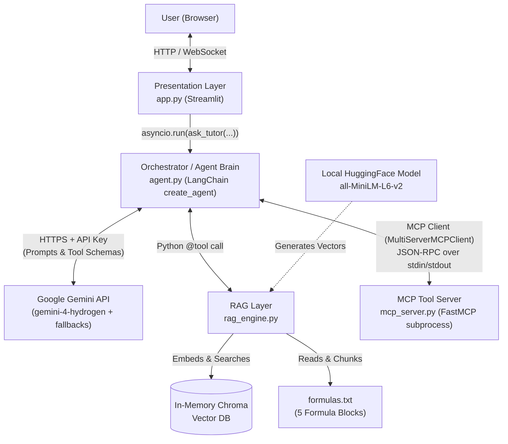

# Smart Math & Formula Tutor — Complete Architecture & Line-by-Line Learning Guide

This guide explains the **system design**, **architecture**, **workflow**, **libraries**, **AI concepts** (LLM, API connection, RAG, Client/Server, MCP, Agent reasoning loop), and **line-by-line code** for every file in the `SmartMath` project.

---

## Table of Contents

1. [System Design & Architecture](#1-system-design--architecture)
2. [Core Concepts Explained](#2-core-concepts-explained)
   - [A. LLM, Model Used & API Connection](#a-llm-model-used--api-connection)
   - [B. RAG (Retrieval-Augmented Generation)](#b-rag-retrieval-augmented-generation)
   - [C. Client, Server & MCP (Model Context Protocol)](#c-client-server--mcp-model-context-protocol)
   - [D. How the AI Agent "Thinks" (ReAct Loop)](#d-how-the-ai-agent-thinks-react-loop)
3. [Libraries Used & Why](#3-libraries-used--why)
4. [End-to-End Runtime Workflow](#4-end-to-end-runtime-workflow)
5. [File-by-File & Line-by-Line Code Walkthrough](#5-file-by-file--line-by-line-code-walkthrough)
   - [`.env.example` & `.env`](#envexample--env)
   - [`.gitignore`](#gitignore)
   - [`requirements.txt`](#requirementstxt)
   - [`formulas.txt`](#formulastxt)
   - [`README.md`](#readmemd)
   - [`rag_engine.py`](#rag_enginepy)
   - [`mcp_server.py`](#mcp_serverpy)
   - [`agent.py`](#agentpy)
   - [`app.py`](#apppy)

---

## 1. System Design & Architecture

`SmartMath` is designed as a **4-layer decoupled architecture** where the Web UI, AI Agent Brain, Local Knowledge Base (RAG), and Calculator Service (MCP) are cleanly separated:

### Architectural Principles Used Here
1. **Separation of Concerns:**
   - `app.py` only handles rendering the chat UI and storing conversation state. It knows nothing about Chroma, embeddings, or MCP JSON-RPC.
   - `mcp_server.py` is a pure, framework-free tool server. It imports **no** LangChain, Gemini, or Streamlit code.
   - `rag_engine.py` handles text loading, chunking, embedding, and vector retrieval in isolation.
   - `agent.py` is the glue/orchestrator connecting the LLM, RAG tool, and MCP client.
2. **Uniform Tool Abstraction:**
   - To the LLM, the local Python RAG function (`search_formulas`) and the external MCP subprocess tools (`add`, `multiply`, `evaluate_expression`) look identical—each is simply a tool with a name, description, and typed input parameters.
3. **Resilience & Safety:**
   - Model fallback protects against Gemini `503` (overloaded) and `429` (rate limit) errors.
   - `ast`-based math parsing in `mcp_server.py` prevents unsafe code execution compared to Python's built-in `eval()`.

---

## 2. Core Concepts Explained

### A. LLM, Model Used & API Connection

- **What is the LLM?**
  A Large Language Model (LLM) is the neural reasoning engine. It is **stateless** on Google's servers—every time `agent.py` calls it, LangChain sends the system prompt, conversation history, available tool definitions, and latest tool outputs, and the LLM predicts the next action (either a tool call or the final text response).
- **Which Model is Used?** (Defined in [`agent.py`](./agent.py#L39-L47))
  - **Primary model:** `gemini-4-hydrogen` (`DEFAULT_MODEL`), or any model specified via `GEMINI_MODEL` in `.env`.
  - **Fallback models:** `gemini-3.1-flash-lite` → `gemini-3.5-flash-lite` → `gemini-3.6-flash` → `gemini-3.7-flash`.
- **How the API Connection Works:**
  1. `load_dotenv()` reads `GOOGLE_API_KEY` (or `GEMINI_API_KEY`) from `.env` into `os.environ`.
  2. `_ensure_api_key()` verifies a key exists before making network calls.
  3. `ChatGoogleGenerativeAI(model=model_name, max_retries=0)` from `langchain-google-genai` establishes HTTPS API requests to Google's Gemini endpoints using your API key.
  4. `max_retries=0` tells LangChain **not** to wait through slow exponential-backoff retries when Google returns `503` or `429`. Instead, `agent.py` catches the error immediately and moves to the next fallback model in `FALLBACK_MODELS`.

### B. RAG (Retrieval-Augmented Generation)

- **Why RAG?**
  LLMs only know what existed in their training data. They do **not** know private files or custom invented facts—such as `Vishal's Constant (V_c) = 42` inside `formulas.txt`. Without RAG, an LLM would either say "I don't know" or hallucinate a wrong answer.
- **How RAG Works in [`rag_engine.py`](./rag_engine.py):**
  1. **Load:** Reads `formulas.txt`.
  2. **Split (Chunking):** Splits text on blank lines (`\n\n`) so each formula block remains intact as one `Document`.
  3. **Embed:** Uses `sentence-transformers/all-MiniLM-L6-v2` locally on your CPU/GPU to turn each text chunk into a dense vector (a list of floating-point numbers representing semantic meaning). Running embeddings locally is free and requires no extra API key.
  4. **Store:** Saves the vectors inside an in-memory `Chroma` vector database.
  5. **Retrieve:** When `search_formulas(query)` is called, the query is embedded into a vector and compared against stored formula vectors via `similarity_search(query, k=2)` to return the top 2 closest matches.
- **Agentic RAG:**
  Instead of stuffing `formulas.txt` into every prompt, `search_formulas` is exposed as a LangChain `@tool`. The AI agent **chooses** when to invoke RAG based on the user's question.

### C. Client, Server & MCP (Model Context Protocol)

- **What is MCP?**
  The Model Context Protocol (MCP) is an open standard ("USB-C for AI") that allows an AI application to discover and invoke external tools using a standard JSON-RPC protocol, regardless of which LLM or agent framework is used.
- **The MCP Server ([`mcp_server.py`](./mcp_server.py)):**
  - Built using `FastMCP("SmartMath Calculator Server")`.
  - Runs as a standalone process communicating over **`stdio`** (reads JSON-RPC requests from `stdin`, writes JSON-RPC responses to `stdout`).
  - Exposes 3 tools via `@mcp.tool()`: `add`, `multiply`, and `evaluate_expression`.
  - Because `stdout` carries the JSON-RPC protocol stream, you must **never** call `print(...)` inside a `stdio` MCP server—it would corrupt the messages.
- **The MCP Client ([`agent.py`](./agent.py#L148-L160)):**
  - `MultiServerMCPClient` acts as the client.
  - It spawns `mcp_server.py` as a child subprocess using `sys.executable` (your active virtual environment's Python).
  - It runs the MCP initialization handshake, calls `await mcp_client.get_tools()` to retrieve the server's tool definitions, and automatically wraps them into LangChain tools.

### D. How the AI Agent "Thinks" (ReAct Loop)

A normal LLM call is **single-step** (`Prompt → Answer`). An AI Agent created with `create_agent(...)` runs an iterative **ReAct (Reason + Act)** loop:

1. **Receive Context:** LangChain sends Gemini:
   - `SYSTEM_PROMPT` (behavior rules)
   - Prior `chat_history`
   - User's new `query`
   - JSON schemas of all 4 tools (`search_formulas`, `add`, `multiply`, `evaluate_expression`)
2. **Reason & Emit Tool Call:** Gemini reads the prompt and rules (e.g., *"ALWAYS call `search_formulas` first"* and *"never compute numbers in your head"*). Instead of replying with text, Gemini returns an `AIMessage` containing `.tool_calls` (e.g., `search_formulas(query="Vishal's Constant")`).
3. **Execute Tool (Act):** LangChain executes the requested tool:
   - If it's `search_formulas`, Python runs `rag_engine.py` in-process.
   - If it's `add`, `multiply`, or `evaluate_expression`, `MultiServerMCPClient` sends a JSON-RPC `tools/call` message over `stdin` to `mcp_server.py` and reads the result from `stdout`.
4. **Observe Result:** LangChain wraps the tool's return value inside a `ToolMessage` and appends it to the conversation state.
5. **Repeat:** LangChain sends the updated message list back to Gemini. Gemini observes the tool output and either requests another tool (e.g., `multiply(42, 15)`) or, if it has everything needed, generates a plain-text `AIMessage` with no `tool_calls`.
6. **Terminate:** When Gemini stops emitting `tool_calls`, `create_agent` finishes and returns the entire `messages` list to `agent.py`.

---

## 3. Libraries Used & Why

| Library | File(s) | Why It Is Used |
|---|---|---|
| `langchain` | `agent.py` | Provides `create_agent`, which implements the multi-step tool-calling agent loop. |
| `langchain-core` | `rag_engine.py` | Provides core abstractions: `Document` (chunk + metadata) and `@tool` (converts Python functions into LLM-callable tools). |
| `langchain-google-genai` | `agent.py` | Provides `ChatGoogleGenerativeAI` to talk to Google Gemini models and bind tool schemas in Gemini's format. |
| `mcp` | `mcp_server.py` | Official MCP SDK providing `FastMCP` to build a standard `stdio` tool server. |
| `langchain-mcp-adapters` | `agent.py` | Provides `MultiServerMCPClient` to spawn MCP servers and convert MCP tools into LangChain tools. |
| `langchain-chroma`, `chromadb` | `rag_engine.py` | Lightweight local vector database for storing embeddings and running `similarity_search`. |
| `langchain-huggingface`, `sentence-transformers` | `rag_engine.py` | Runs `all-MiniLM-L6-v2` locally to generate text embeddings without paying for or calling an external embedding API. |
| `python-dotenv` | `agent.py`, `app.py` | Loads environment variables from `.env` into `os.environ` so secrets never live in Python files. |
| `streamlit` | `app.py` | Builds an interactive web chat UI (`st.chat_message`, `st.chat_input`, `st.expander`, `st.session_state`) purely in Python. |

**Standard Library Modules Used:**
- `asyncio` (`agent.py`, `app.py`): Required because `MultiServerMCPClient.get_tools()` and `agent.ainvoke()` are asynchronous (`async`/`await`).
- `ast` & `operator` (`mcp_server.py`): Parses arithmetic strings into an Abstract Syntax Tree and evaluates only whitelisted math operations safely.
- `functools.lru_cache` (`rag_engine.py`): Caches the Chroma vector store in memory so the embedding model is loaded only once per process.
- `pathlib.Path` (`rag_engine.py`, `agent.py`): Builds OS-independent absolute paths to `formulas.txt` and `mcp_server.py`.
- `os`, `sys`, `typing` (`agent.py`, `app.py`): Reads env vars (`os.getenv`), locates the active Python interpreter (`sys.executable`), and provides type annotations (`Any`).

---

## 4. End-to-End Runtime Workflow

Trace of what happens when the user asks:
> *"Look up Vishal's Constant, multiply it by 15, and then add 8."*

1. **UI Trigger ([`app.py`](./app.py#L114-L130)):**
   `user_prompt` is captured from `st.chat_input` or a sidebar button. `app.py` displays the user bubble and calls `asyncio.run(ask_tutor(user_prompt, chat_history=history_before_turn))`.
2. **Environment & MCP Startup ([`agent.py`](./agent.py#L143-L165)):**
   - `_ensure_api_key()` confirms `GOOGLE_API_KEY` is present.
   - `MultiServerMCPClient` launches `python mcp_server.py` and retrieves `add`, `multiply`, `evaluate_expression`.
   - `all_tools` combines those 3 MCP tools + `search_formulas`.
3. **Agent Step 1 — RAG Lookup:**
   - Gemini outputs `tool_calls: [{"name": "search_formulas", "args": {"query": "Vishal's Constant"}}]`.
   - `_get_vector_store()` loads `all-MiniLM-L6-v2` (on first run), embeds `formulas.txt`, and returns the `Vishal's Constant (V_c) = 42` chunk.
4. **Agent Step 2 & 3 — MCP Calculations:**
   - Gemini sees `42`, calls MCP `multiply(a=42, b=15)` → `mcp_server.py` returns `630.0`.
   - Gemini calls MCP `add(a=630, b=8)` → `mcp_server.py` returns `638.0` (or uses `evaluate_expression("42 * 15 + 8")`).
5. **Agent Final Answer:**
   - Gemini outputs the step-by-step explanation with no further `tool_calls`.
6. **UI Rendering ([`agent.py`](./agent.py#L215-L225) & [`app.py`](./app.py#L138-L147)):**
   - `_extract_thought_process` parses `new_messages` into structured steps tagged `RAG (rag_engine.py)` vs `MCP (mcp_server.py)`.
   - `app.py` renders the final answer and puts the tool trace inside the expandable **Agent Thought Process (Tools Used)** box, then saves everything to `st.session_state.messages`.

---

## 5. File-by-File & Line-by-Line Code Walkthrough

### `.env.example` & `.env`

**[`./.env.example`](./.env.example#L1-L4)**
- **Lines 1–2:** Comments telling you to generate a free key at Google AI Studio and copy `.env.example` to `.env`.
- **Line 3:** `GOOGLE_API_KEY=your_gemini_api_key_here` — placeholder template.
- **`.env` (local untracked file):** Stores your real `GOOGLE_API_KEY` (and optional `GEMINI_MODEL` override). Never commit `.env` to version control.

---

### [`.gitignore`](./.gitignore#L1-L17)

- **Lines 1–2:** Ignores `.env` to prevent leaking API secrets.
- **Lines 4–7:** Ignores Python bytecode caches (`__pycache__/`, `*.py[cod]`, `*$py.class`).
- **Lines 9–12:** Ignores local Python virtual environments (`.venv/`, `venv/`, `env/`).
- **Lines 14–17:** Ignores persisted Chroma database folders (`chroma_db/`) and OS thumbnail/metadata files (`.DS_Store`, `Thumbs.db`).

---

### [`requirements.txt`](./requirements.txt#L1-L18)

- **Lines 1–4:** Core LangChain framework and Gemini integration (`langchain`, `langchain-core`, `langchain-google-genai`).
- **Lines 6–8:** MCP protocol server SDK (`mcp`) and LangChain adapter (`langchain-mcp-adapters`).
- **Lines 10–14:** Local RAG stack (`langchain-chroma`, `chromadb`, `langchain-huggingface`, `sentence-transformers`).
- **Lines 16–18:** `.env` loader (`python-dotenv`) and web UI (`streamlit`).

---

### [`formulas.txt`](./formulas.txt#L1-L19)

A plain-text knowledge base containing 5 formula blocks separated by blank lines (`\n\n`):
- **Lines 1–3:** `Vishal's Constant (V_c) = 42` — fictional constant used to prove RAG retrieves from local files rather than LLM memory.
- **Lines 5–7:** Kinetic Energy (`KE = 0.5 * m * v^2`).
- **Lines 9–11:** Ohm's Law (`V = I * R`).
- **Lines 13–15:** Compound Interest (`A = P * (1 + r / n)^(n * t)`).
- **Lines 17–19:** Quadratic Formula (`x = (-b +/- sqrt(b^2 - 4*a*c)) / (2*a)`).

---

### [`README.md`](./README.md#L1-L85)

- **Lines 1–16:** Project title and summary table mapping all 5 core concepts to their files.
- **Lines 19–65:** Step-by-step installation: creating `.venv`, installing `requirements.txt` (noting the ~90 MB HuggingFace model download on first run), configuring `.env` (`GOOGLE_API_KEY` and optional `GEMINI_MODEL`), and launching `streamlit run app.py` or `python agent.py`.
- **Lines 69–85:** Three example prompts demonstrating MCP-only, RAG-only, and combined RAG + MCP execution.

---

### [`rag_engine.py`](./rag_engine.py#L1-L77)

- **Lines 1–18:** Module docstring explaining the 3 RAG phases and the `@tool` concept.
- **Line 20:** `from functools import lru_cache` — used to cache the vector store in memory.
- **Line 21:** `from pathlib import Path` — reliable cross-platform path resolution.
- **Lines 23–26:** Imports `Chroma`, `Document`, `tool`, and `HuggingFaceEmbeddings`.
- **Line 28:** `FORMULAS_FILE = Path(__file__).parent / "formulas.txt"` — locates `formulas.txt` next to `rag_engine.py`.
- **Lines 31–32:** `@lru_cache(maxsize=1)` ensures `_get_vector_store()` executes only once per Python process; subsequent calls return the cached `Chroma` object immediately.
- **Lines 33–41:** Function docstring explaining why in-memory Chroma + `@lru_cache` is used.
- **Line 42:** Reads `formulas.txt` as UTF-8 text into `raw_text`.
- **Line 46:** Splits `raw_text` on `"\n\n"`, strips whitespace, and skips empty strings, producing 5 clean formula chunks.
- **Lines 47–50:** Wraps each chunk in a `Document(page_content=chunk, metadata={"source": FORMULAS_FILE.name, "chunk_id": i})`.
- **Line 53:** Creates the local embedding model `HuggingFaceEmbeddings(model_name="sentence-transformers/all-MiniLM-L6-v2")`.
- **Lines 55–59:** `Chroma.from_documents(...)` generates embeddings for all 5 documents and indexes them in an in-memory Chroma collection named `"smart_math_formulas"`.
- **Lines 62–69:** `@tool` registers `search_formulas(query: str) -> str`. Its docstring tells Gemini *what* the knowledge base contains and instructs it to always use this tool for formulas/custom constants.
- **Line 70:** Retrieves the cached `Chroma` instance.
- **Line 72:** Runs `vector_store.similarity_search(query, k=2)` to get the 2 most semantically similar formula documents.
- **Lines 74–75:** Returns `"No matching formulas found in formulas.txt."` if nothing matched.
- **Line 77:** Joins the retrieved `doc.page_content` strings with `"\n\n---\n\n"` and returns the text to the agent.

---

### [`mcp_server.py`](./mcp_server.py#L1-L89)

- **Lines 1–18:** Module docstring explaining MCP and emphasizing that no LangChain/LLM/Streamlit libraries are imported.
- **Lines 20–22:** Imports `ast`, `operator`, and `FastMCP`.
- **Line 25:** `mcp = FastMCP("SmartMath Calculator Server")` initializes the MCP server with a display name.
- **Lines 28–36:** `_BINARY_OPERATORS` maps safe Python AST binary operator nodes (`Add`, `Sub`, `Mult`, `Div`, `FloorDiv`, `Mod`, `Pow`) to `operator` functions.
- **Lines 38–41:** `_UNARY_OPERATORS` maps unary `+` (`UAdd`) and `-` (`USub`) to `operator.pos` and `operator.neg`.
- **Lines 44–56:** `_safe_eval_node(node: ast.AST) -> float` recursively evaluates a parsed expression tree:
  - **Lines 46–47:** Unwraps the root `ast.Expression` node via `node.body`.
  - **Lines 48–49:** Accepts numeric constants (`int` or `float`) and returns `float(node.value)`.
  - **Lines 50–53:** Evaluates `ast.BinOp` nodes recursively if the operator is in `_BINARY_OPERATORS`.
  - **Lines 54–55:** Evaluates `ast.UnaryOp` nodes recursively if the operator is in `_UNARY_OPERATORS`.
  - **Line 56:** Raises `ValueError` for any unsupported syntax (preventing arbitrary code execution).
- **Lines 61–64:** `@mcp.tool()` exposes `add(a: float, b: float) -> float`.
- **Lines 67–70:** `@mcp.tool()` exposes `multiply(a: float, b: float) -> float`.
- **Lines 73–83:** `@mcp.tool()` exposes `evaluate_expression(expression: str) -> float`:
  - **Line 81:** Trims whitespace and replaces `^` with `**` so math notation like `v^2` works in Python's parser.
  - **Line 82:** `ast.parse(normalized, mode="eval")` builds the AST safely without running code.
  - **Line 83:** Evaluates the AST via `_safe_eval_node(tree)`.
- **Lines 86–89:** Runs `mcp.run(transport="stdio")` when executed as a script. Includes the critical warning never to use `print(...)` because `stdout` is reserved for JSON-RPC messages.

---

### [`agent.py`](./agent.py#L1-L236)

- **Lines 1–19:** Module docstring explaining how LLM, RAG, MCP, LangChain, and the AI Agent loop fit together.
- **Lines 21–32:** Imports `asyncio`, `os`, `sys`, `Path`, `Any`, `load_dotenv`, `create_agent`, `ChatGoogleGenerativeAI`, `MultiServerMCPClient`, and `search_formulas`.
- **Line 35:** `load_dotenv()` loads `.env` variables into `os.environ`.
- **Line 37:** `MCP_SERVER_PATH = Path(__file__).parent / "mcp_server.py"` locates the MCP server script.
- **Lines 39–47:** Defines `DEFAULT_MODEL = "gemini-4-hydrogen"` and `FALLBACK_MODELS`.
- **Lines 49–60:** `SYSTEM_PROMPT` defines the tutor persona and enforces tool-usage rules (always use `search_formulas` for formulas/constants, always use MCP tools for arithmetic, combine both when needed, explain step-by-step).
- **Lines 63–75:** `_extract_text(content)` safely normalizes message content whether it arrives as a `str`, a `list` of strings/dicts with `"text"`, or another type.
- **Lines 78–84:** `_ensure_api_key()` raises a descriptive `ValueError` if neither `GOOGLE_API_KEY` nor `GEMINI_API_KEY` is present.
- **Lines 87–130:** `_extract_thought_process(new_messages, mcp_tool_names)`:
  - **Lines 92–93:** Initializes `steps_by_id` (for matching tool outputs back to their calls) and `ordered_steps`.
  - **Lines 95–110:** Inspects each message for `.tool_calls` (emitted by `AIMessage`), determines `source` (`"MCP (mcp_server.py)"` vs `"RAG (rag_engine.py)"`), creates a step dict with `output=None`, and indexes it by `call_id`.
  - **Lines 113–128:** Inspects `ToolMessage` items (`type == "tool"`), extracts `output_text`, and attaches it to the matching step in `steps_by_id` (or appends a fallback step if `tool_call_id` is absent).
  - **Line 130:** Returns `ordered_steps`.
- **Lines 133–143:** `async def ask_tutor(query, chat_history=None)` validates the API key via `_ensure_api_key()`.
- **Lines 148–156:** Configures `MultiServerMCPClient` with `"math_calculator"` using `transport="stdio"`, `command=sys.executable`, and `args=[str(MCP_SERVER_PATH)]`.
- **Lines 159–160:** Calls `await mcp_client.get_tools()` to start the MCP server and collect its LangChain-wrapped tools, plus their names in `mcp_tool_names`.
- **Line 164:** Merges `mcp_tools` and `search_formulas` into `all_tools`.
- **Lines 167–172:** Sanitizes `chat_history` to `{"role", "content"}` pairs for `"user"` and `"assistant"` roles, then appends the current `query`.
- **Lines 175–180:** Reads `GEMINI_MODEL` (falling back to `DEFAULT_MODEL`), builds a deduplicated `candidate_models` list (`dict.fromkeys`), and initializes `result`, `used_model`, and `last_error`.
- **Lines 182–205:** Iterates through `candidate_models`:
  - **Line 186:** Creates `ChatGoogleGenerativeAI(model=model_name, max_retries=0)`.
  - **Lines 191–195:** Calls `create_agent(model=llm, tools=all_tools, system_prompt=SYSTEM_PROMPT)`.
  - **Lines 196–199:** Runs `await agent.ainvoke({"messages": input_messages})`, records `used_model`, and breaks out of the loop on success.
  - **Lines 200–205:** Catches errors; if `"503"`, `"429"`, `"UNAVAILABLE"`, or `"RESOURCE_EXHAUSTED"` appears, saves `last_error` and continues to the next model; otherwise re-raises immediately.
- **Lines 207–210:** Raises `RuntimeError` if every model in `candidate_models` failed.
- **Lines 212–216:** Slices `all_messages[len(input_messages):]` so only messages generated during *this* turn are parsed by `_extract_thought_process`.
- **Lines 219–225:** Extracts the final answer from `all_messages[-1].content` and returns `{"answer", "steps", "model"}`.
- **Lines 228–236:** `if __name__ == "__main__":` terminal smoke test that runs `ask_tutor("What is Vishal's Constant multiplied by 10?")` and prints the thought process and final answer.

---

### [`app.py`](./app.py#L1-L147)

- **Lines 1–11:** Module docstring explaining the Streamlit presentation layer.
- **Lines 13–22:** Imports `asyncio`, `os`, `Any`, `streamlit as st`, `load_dotenv`, and `ask_tutor`, then loads `.env`.
- **Lines 24–28:** Configures the Streamlit page title, emoji icon, and centered layout.
- **Lines 31–35:** `SAMPLE_PROMPTS` dictionary defining 3 test buttons (MCP Only, RAG Only, Both RAG + MCP).
- **Lines 38–64:** `_render_thought_process(steps, key_prefix, model_name=None)`:
  - **Lines 42–44:** Opens a collapsed `st.expander("Agent Thought Process (Tools Used)")` and shows the active model name.
  - **Lines 45–47:** Displays an info message if no tools were called.
  - **Lines 49–64:** Loops over `steps`, displays a `📚 RAG` or `🔧 MCP` badge, tool name, arguments, and a disabled `st.text_area` (keyed uniquely with `f"{key_prefix}_{idx}"`), separated by dividers.
- **Lines 68–92:** Sidebar (`with st.sidebar:`):
  - **Lines 69–77:** Displays the architecture summary.
  - **Lines 79–83:** Shows whether `GOOGLE_API_KEY` or `GEMINI_API_KEY` is detected.
  - **Lines 85–88:** Renders sample prompt buttons; clicking stores the prompt in `st.session_state.queued_prompt`.
  - **Lines 90–92:** `"Clear Chat"` button empties `st.session_state.messages` and forces `st.rerun()`.
- **Lines 96–100:** Renders the main title, caption, and initializes `st.session_state.messages = []` on first load.
- **Lines 103–111:** Loops through `st.session_state.messages` to re-render prior chat history and each assistant turn's thought process expander.
- **Lines 114–115:** Pops `queued_prompt` (if a sidebar button was clicked) or reads `st.chat_input(...)`.
- **Lines 117–147:** Runs when `user_prompt` is non-empty:
  - **Lines 119–120:** Renders the user's message bubble.
  - **Lines 122–123:** Captures `history_before_turn` (prior messages only) and appends the new user message to `st.session_state.messages`.
  - **Lines 126–136:** Inside the assistant bubble and a loading spinner, calls `asyncio.run(ask_tutor(user_prompt, chat_history=history_before_turn))` and catches any error into a user-friendly warning string.
  - **Lines 138–143:** Renders the final Markdown answer and the `_render_thought_process` expander.
  - **Lines 145–147:** Saves the assistant's `content`, `steps`, and `model` to `st.session_state.messages` for future reruns.
